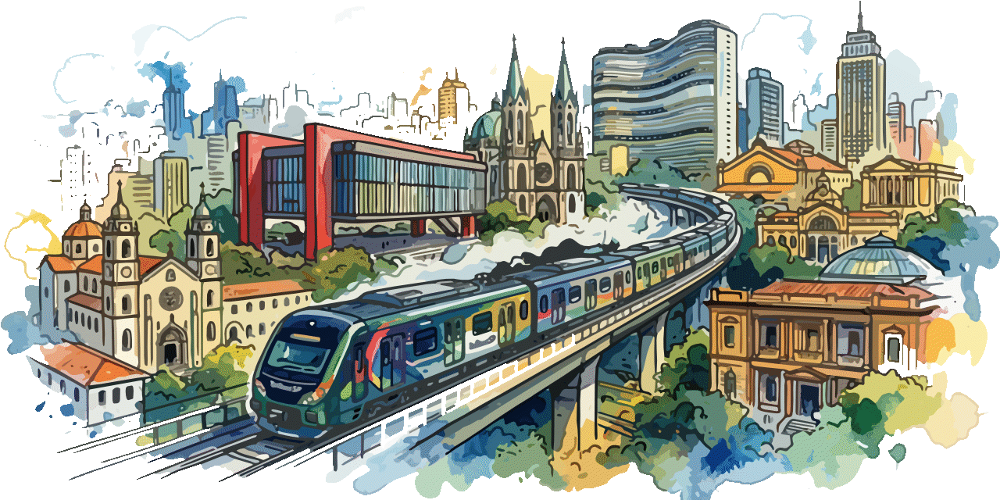

# SP Trilhos - Manual do Usuário e do Desenvolvedor

**SP Trilhos - Guia do Metrô e Trem de São Paulo** é um aplicativo web progressivo (PWA) que planeja rotas de metrô, trem e monotrilho na Grande São Paulo, mostra o mapa oficial da malha em vetor e reúne as regras de uso do sistema. Depois de aberto uma vez com internet, funciona também sem conexão.

- **App:** https://magpe-stack.github.io/TrilhosSP/
- **Repositório:** https://github.com/magpe-stack/TrilhosSP
- **Manual (este arquivo):** https://github.com/magpe-stack/TrilhosSP/blob/main/README.md

<p align="center">
  
  <br>
  <em>SP Trilhos — Ilustração em aquarela da malha metroferroviária e marcos icônicos de São Paulo.</em>
</p>

## Sumário

1. [Visão geral](#1-visão-geral)
2. [Primeiros passos](#2-primeiros-passos)
3. [Conhecendo a interface](#3-conhecendo-a-interface)
4. [Planejando uma rota](#4-planejando-uma-rota)
5. [O mapa interativo](#5-o-mapa-interativo)
6. [O Guia do Passageiro](#6-o-guia-do-passageiro)
7. [Projetos](#7-projetos)
8. [Backup, importação, exportação e impressão](#8-backup-importação-exportação-e-impressão)
9. [Compartilhar](#9-compartilhar)
10. [Preferências: tema, tela cheia e instalação](#10-preferências-tema-tela-cheia-e-instalação)
11. [Uso offline](#11-uso-offline)
12. [Acessibilidade e atalhos de teclado](#12-acessibilidade-e-atalhos-de-teclado)
13. [Privacidade e segurança dos dados](#13-privacidade-e-segurança-dos-dados)
14. [Perguntas frequentes e solução de problemas](#14-perguntas-frequentes-e-solução-de-problemas)
15. [Limitações conhecidas](#15-limitações-conhecidas)
16. [Manual do desenvolvedor](#16-manual-do-desenvolvedor)
17. [Fontes, créditos e aviso legal](#17-fontes-créditos-e-aviso-legal)
18. [Glossário](#18-glossário)

---

## 1. Visão geral

### 1.1 Para que serve

O SP Trilhos responde a três perguntas comuns de quem usa transporte sobre trilhos em São Paulo:

1. **Como chego de uma estação a outra?** O buscador de rotas calcula o trajeto, indica onde fazer baldeação, em que sentido embarcar e quantas paradas faltam.
2. **Onde estou no mapa?** O mapa oficial da malha metroferroviária pode ser ampliado, movido e destacado por linha.
3. **O que posso e o que não posso fazer?** O Guia do Passageiro resume regras de bicicletas, animais, bagagens, achados e perdidos e bilhetagem.

### 1.2 Origem do nome

"SP" vem de São Paulo. "Trilhos" é a palavra que reúne metrô, trem e monotrilho: tudo o que circula sobre trilhos e costura a capital e os municípios vizinhos.

### 1.3 O que o aplicativo cobre

A base de dados inclui 14 linhas: 1-Azul, 2-Verde, 3-Vermelha, 4-Amarela e 5-Lilás (metrô e concessões), 7-Rubi, 8-Diamante, 9-Esmeralda, 10-Turquesa, 11-Coral, 12-Safira e 13-Jade (trens) e 15-Prata (monotrilho). As estações que têm terminal de ônibus integrado são identificadas. As Linhas 6-Laranja e 17-Ouro aparecem no mapa visual, mas ainda não existem na base de rotas.

### 1.4 O que o aplicativo não é

O SP Trilhos é um projeto independente, sem vínculo oficial com o Metrô, a CPTM ou as operadoras. Ele **não mostra horários de chegada em tempo real, interrupções ou lotação**. Os tempos de viagem são estimativas. Para informações operacionais do dia, consulte sempre os canais oficiais.

---

## 2. Primeiros passos

### 2.1 Abrindo o app

Abra https://magpe-stack.github.io/TrilhosSP/ no navegador. Recomendamos o Google Chrome, no celular ou no computador. Ao abrir, você verá uma tela de abertura animada, que dura cerca de três segundos, e depois a tela inicial, sempre no **modo claro**.

### 2.2 Instalando como aplicativo

Instalar o app o coloca na tela inicial, abre em janela própria (sem barra do navegador) e facilita o uso offline.

- **No menu do app:** toque no botão de três traços no canto superior direito e escolha **Instalar PWA**. O navegador mostrará uma confirmação.
- **Pelo Chrome:** abra o menu do navegador (três pontos) e escolha **Instalar app** ou **Adicionar à tela inicial**.

Se o item aparecer desativado com o texto "App instalado", o aplicativo já está instalado neste aparelho. Se o navegador não oferecer a instalação, o app avisa e indica o caminho pelo menu do Chrome.

### 2.3 Primeira visita e modo offline

Na primeira visita, mantenha a internet ligada por alguns segundos. Nesse momento o app guarda no aparelho todos os arquivos de que precisa, incluindo o mapa (cerca de 4 MB). Depois disso você pode abri-lo em túneis, estações subterrâneas ou sem pacote de dados.

---

## 3. Conhecendo a interface

### 3.1 Cabeçalho

No topo ficam:

- **Logotipo "SP Trilhos"** (à esquerda). Tocar nele, em qualquer tela, leva instantaneamente de volta à página inicial.
- **Botão de tela cheia**, que alterna entre tela cheia e janela normal.
- **Menu hambúrguer** (três traços), que abre o menu lateral.

### 3.2 Menu lateral

O menu abre pela direita e reúne todas as funções, cada uma com um ícone:

| Item | O que faz |
|---|---|
| Início - Planejar rota | Volta ao buscador de rotas |
| Mapa da malha | Abre o mapa |
| Guia do Passageiro | Abre o guia de regras |
| Novo Projeto | Cria um projeto em branco |
| Meus Projetos | Lista os projetos salvos |
| Salvar projeto atual | Grava o estado atual no projeto ativo |
| Exportar projeto | Baixa um arquivo com o projeto |
| Importar projeto / backup | Carrega um arquivo exportado antes |
| Imprimir projeto | Imprime a ficha completa do projeto |
| Compartilhar | Envia a rota por outros aplicativos |
| Backup completo | Baixa um arquivo com todos os projetos |
| Modo escuro / Modo claro | Alterna o tema |
| Tela cheia | Alterna a tela cheia |
| Instalar PWA | Instala o aplicativo |
| Sobre | Explica a proposta e a origem do nome |
| Ajuda (Manual / README) | Abre este manual no GitHub |
| GitHub (código-fonte) | Abre o repositório |

Para fechar o menu, toque no X, toque fora dele ou pressione **Esc**.

### 3.3 Navegação inferior

Na parte de baixo da tela do celular há quatro atalhos ao alcance do polegar: **Rota**, **Mapa**, **Guia** e **Projetos**. Em telas grandes (a partir de 1024 pixels de largura), essa barra vira um menu horizontal no topo do conteúdo, sem o item Mapa, porque o mapa já fica visível ao lado do buscador.

### 3.4 Layouts

- **Celular:** uma coluna. O buscador e o mapa alternam entre si pelos atalhos Rota e Mapa. O projeto foi pensado para uso com uma mão, como no Samsung Galaxy A52: botões grandes, alvos de toque de pelo menos 44 pixels e a navegação principal na base da tela.
- **Computador (split-view):** o painel da esquerda traz o formulário e o resultado da rota; o da direita traz o mapa. O painel da esquerda acompanha a rolagem da página.

### 3.5 Rodapé

O rodapé tem três botões: o **logotipo SP Trilhos**, que abre o app em nova aba; **GitHub**, que abre o repositório; e **Ajuda**, que abre este manual. Abaixo deles há um aviso de que o projeto é independente e de que os tempos são estimativas.

---

## 4. Planejando uma rota

### 4.1 Passo a passo

1. Na tela **Rota**, toque no campo **Origem** e comece a digitar o nome da estação, por exemplo "Tucuruvi".
2. Escolha uma das sugestões da lista. Cada sugestão mostra as linhas que passam pela estação e um ícone de ônibus quando há terminal de ônibus.
3. Faça o mesmo no campo **Destino**.
4. Escolha a **Preferência de trajeto** (veja a seção 4.3).
5. Toque em **Calcular rota**.

O resultado aparece logo abaixo do formulário e o mapa passa a destacar as linhas usadas.

### 4.2 Dicas de digitação

- Não é preciso digitar acentos: "Sao Bento" encontra "São Bento".
- Estações que são o mesmo local físico em linhas diferentes aparecem como uma só. Por exemplo, "Consolação / Paulista" é a estação onde se cruzam a Linha 2 e a Linha 4.
- Se o nome digitado não corresponder a nenhuma estação, o app mostra uma mensagem de erro e coloca o cursor no campo com problema. Escolha uma sugestão da lista.
- O botão com setas, entre os campos, **inverte origem e destino** e já recalcula a rota.
- **Limpar** apaga os campos, o resultado e o destaque do mapa.

### 4.3 Preferência de trajeto

- **Mais rápida** (padrão): minimiza o tempo estimado total. Aceita baldeações quando elas economizam tempo.
- **Menos baldeações:** penaliza fortemente cada troca de linha. Útil para quem viaja com bagagem, criança ou mobilidade reduzida e prefere um trajeto mais simples, mesmo que um pouco mais longo.

Ao trocar a preferência com origem e destino preenchidos, a rota é recalculada na hora.

### 4.4 Sugerir apenas estações com terminal de ônibus

Marque esta opção para que a lista de sugestões mostre somente estações que têm terminal de ônibus integrado. É útil quando você precisa completar a viagem de ônibus (municipal ou metropolitano) e quer escolher uma estação de desembarque que tenha esse terminal.

### 4.5 Lendo o resultado

O resultado traz:

- **Resumo em três números:** minutos estimados, número de paradas e número de baldeações.
- **Faixa colorida:** cada trecho na cor oficial da linha, com largura proporcional ao número de paradas.
- **Lista de etapas:**
  - "Embarque em **L1** Tucuruvi" indica a linha e a estação de partida.
  - A linha seguinte traz o nome completo da linha, o **sentido** (a estação terminal para a qual o trem vai), o número de paradas e a estação de desembarque.
  - **Ver N estações intermediárias** abre a lista das estações pelas quais você passa. As que têm terminal de ônibus recebem um ícone de ônibus.
  - O quadro tracejado "Baldeação em ..." indica onde descer e qual linha pegar em seguida.
- **Botões de ação:** Ver no mapa, Salvar projeto, Compartilhar e Imprimir.

### 4.6 Como o tempo é estimado

O app soma: 3 minutos de espera inicial, cerca de 2,0 minutos por parada nas linhas 1, 2, 3, 4, 5 e 15 e cerca de 2,8 minutos por parada nas demais, mais 6 minutos por baldeação. São valores médios. Intervalos entre trens, horário do dia e interrupções alteram o tempo real.

### 4.7 O algoritmo, em resumo

O cálculo usa uma busca em largura ponderada (equivalente ao algoritmo de Dijkstra, com fila de prioridade) sobre um grafo em que cada estação de cada linha é um nó. As ligações são os trechos entre estações vizinhas e as baldeações. Cada ligação tem um custo em minutos, e a rota escolhida é a de menor custo total. Tudo roda no seu aparelho, sem internet.

---

## 5. O mapa interativo

### 5.1 O que é

O mapa é o arquivo vetorial oficial da malha metroferroviária, incorporado ao app. Por ser vetor, permanece nítido em qualquer nível de zoom. Ele inclui a legenda das linhas, os corredores metropolitanos de ônibus, os terminais e os telefones das operadoras.

### 5.2 Como navegar

| Ação | Celular | Computador |
|---|---|---|
| Mover | Arrastar com um dedo | Arrastar com o mouse |
| Ampliar/reduzir | Pinça com dois dedos ou botões + e − | Roda do mouse ou botões + e − |
| Reiniciar a visão | Botão de setas circulares | Botão de setas circulares ou tecla 0 |

Por teclado, foque o mapa (tecla Tab) e use as setas para mover, **+** e **−** para o zoom e **0** para reiniciar.

### 5.3 Destaque dinâmico

Quando uma rota é calculada, as linhas usadas **acendem** e o restante do mapa **esmaece**. Para ver o trajeto no mapa, toque em **Ver no mapa** no resultado (no celular isso abre o painel do mapa).

### 5.4 Chips de linha

Acima do mapa há um botão para cada linha, na cor oficial. Toque em um chip para destacar aquela linha; toque de novo para desfazer. É possível combinar várias linhas. Os chips também refletem a rota calculada.

### 5.5 Limitação do destaque

O arquivo de mapa não identifica cada estação individualmente. Por isso o destaque é feito **por linha inteira**, e não apenas pelo trecho percorrido. O trecho exato, estação por estação, está sempre na lista de etapas.

---

## 6. O Guia do Passageiro

Abra pelo menu ou pelo atalho **Guia**. O guia é dividido em três abas: **Metrô**, **Trens** e **Ônibus Metropolitanos**.

### 6.1 Busca

O campo **Buscar no guia** filtra os cartões da aba atual enquanto você digita (por exemplo "bicicleta", "pet", "achados", "bilhete"). Uma linha de status informa quantos resultados há na aba e **quantos existem nas outras abas**. Quando você busca, os cartões encontrados já abrem sozinhos.

### 6.2 Cartões sanfonados

Cada assunto é um cartão que se abre e fecha ao toque. Isso mantém a tela organizada e permite ler só o que interessa. Os cartões podem ser operados também pelo teclado (Tab e Enter ou Espaço).

### 6.3 O que cada aba traz

**Metrô**

- Bicicletas: dias e horários permitidos, limite de bicicletas por trem, uso do último vagão, regras de bicicleta dobrável e bicicletários.
- Animais de estimação: peso, caixa de transporte e horários fora de pico; cão-guia.
- Bagagens e volumes.
- Achados e perdidos: onde ficam os postos, horários, telefone e prazo de guarda.
- Bilhetagem e tarifas.
- Acessibilidade e prioridade.

**Trens**

- Linhas e operadoras, gerada a partir da base de dados do app.
- Bicicletas na CPTM, inclusive bicicletas elétricas, grupos e bicicletários.
- Pets, bagagens e Expresso Aeroporto.
- Achados e perdidos de CPTM, TIC Trens e linhas 8 e 9.
- Bilhetagem e tarifas, incluindo integrações específicas.
- Contatos das operadoras, com telefones que podem ser tocados para ligar.

**Ônibus Metropolitanos**

- Terminais de ônibus integrados e como filtrá-los no buscador.
- Corredores metropolitanos (A, B e C).
- Tarifas.
- Pets, bicicletas, bagagens e achados e perdidos.

### 6.4 Sobre a atualidade das informações

As regras e os valores foram consultados em novembro de 2026, e cada cartão indica a fonte quando aplicável. Tarifas são reajustadas e regras mudam. **Confirme sempre nos canais oficiais antes de viajar.**

---

## 7. Projetos

### 7.1 O que é um projeto

Um projeto guarda um planejamento completo para você voltar a ele depois. Ele inclui:

- nome e anotações;
- origem, destino e preferência de trajeto;
- o filtro de terminais de ônibus;
- a rota calculada;
- as linhas em destaque e a posição e o zoom do mapa;
- a aba e a busca do guia.

Exemplos de uso: "Casa → Trabalho", "Viagem ao aeroporto", "Passeio de domingo".

### 7.2 Criar um Novo Projeto

1. Abra o menu e toque em **Novo Projeto** (ou use o botão na tela Projetos).
2. Digite o **nome** (obrigatório, até 80 caracteres) e, se quiser, **anotações** (até 2.000 caracteres), como horários e pontos de encontro.
3. Toque em **Criar projeto**.

O novo projeto começa com o buscador limpo e passa a ser o **projeto ativo**.

### 7.3 Projeto ativo e salvamento

O projeto ativo é indicado no topo da tela de rota ("Projeto ativo: ..."). Toda vez que você calcula uma rota, o estado é gravado nele automaticamente. Você também pode tocar em **Salvar projeto** (no resultado ou no menu) para gravar manualmente, incluindo a posição do mapa. Se não houver projeto ativo, **Salvar projeto** cria um novo, com o nome "Origem → Destino".

### 7.4 Meus Projetos

A tela **Projetos** lista tudo o que você salvou, com data da última atualização, resumo da rota e as linhas usadas. Cada cartão tem cinco ações:

- **Abrir:** restaura o projeto na tela de rota, com o mapa como estava.
- **Exportar:** baixa um arquivo com este projeto.
- **Imprimir:** imprime a ficha do projeto.
- **Duplicar:** cria uma cópia chamada "(cópia)".
- **Excluir:** apaga o projeto, depois de uma confirmação. Não há como desfazer.

### 7.5 Onde os projetos ficam

Os projetos ficam **somente no aparelho e no navegador** em que foram criados (armazenamento local). Limpar os dados do site, desinstalar o app ou trocar de aparelho apaga ou separa os projetos. Faça backup regularmente (seção 8).

---

## 8. Backup, importação, exportação e impressão

### 8.1 Exportar um projeto

Em **Exportar projeto** (menu) ou no botão **Exportar** do cartão, o navegador baixa um arquivo `.json` chamado `sptrilhos-nome-do-projeto-AAAA-MM-DD.json`. Ele contém todo o estado do projeto descrito na seção 7.1, além da versão do app e da data. Se você não tem projeto ativo mas há uma rota na tela, o app exporta um projeto com o estado atual.

### 8.2 Backup completo

**Backup completo** (menu ou tela Projetos) gera um único arquivo, `sptrilhos-backup-completo-AAAA-MM-DD.json`, com **todos os projetos**, o projeto ativo e as preferências (tema). Guarde-o no e-mail, na nuvem ou em um pendrive.

### 8.3 Importar

1. Menu > **Importar projeto / backup** (ou botão **Importar** na tela Projetos).
2. Selecione um arquivo `.json` exportado pelo SP Trilhos.

O app reconhece sozinho se é um projeto ou um backup completo. Os projetos importados são **adicionados** à sua lista com novos identificadores, sem sobrescrever os que você já tem. Se o arquivo for de backup, o tema salvo nele também é aplicado.

Por segurança, o app valida o arquivo: recusa formatos desconhecidos, limita o tamanho (20 MB) e o comprimento dos textos, e nunca executa conteúdo do arquivo. Se algo estiver errado, uma mensagem curta explica o motivo.

### 8.4 Restaurar em outro aparelho

1. No aparelho antigo, gere o **Backup completo**.
2. Transfira o arquivo para o novo aparelho.
3. No novo aparelho, abra o app e use **Importar**.

### 8.5 Imprimir

**Imprimir projeto** (menu, resultado ou cartão do projeto) abre a janela de impressão do navegador com uma ficha limpa, sem menus, contendo:

- nome do projeto, datas de criação, atualização e impressão;
- origem, destino, preferência, opção de terminais e linhas em destaque;
- anotações;
- resumo da rota, faixa colorida e todas as etapas, com as estações intermediárias já abertas;
- fonte e aviso sobre estimativas.

Na janela do navegador você pode escolher **Salvar como PDF** como destino para gerar um arquivo em vez de papel.

---

## 9. Compartilhar

O botão **Compartilhar** usa o recurso nativo do aparelho (Web Share API):

- Em celulares compatíveis, abre a folha de compartilhamento para enviar a rota por WhatsApp, e-mail, mensagens e outros aplicativos. Quando possível, o arquivo do projeto também é anexado.
- Em computadores ou navegadores sem esse recurso, o texto da rota é **copiado** para a área de transferência, e o app avisa.

O texto compartilhado traz origem, destino, tempo estimado, as etapas por linha e o endereço do app.

---

## 10. Preferências: tema, tela cheia e instalação

### 10.1 Modo claro e modo escuro

O app **sempre inicia no modo claro**, independentemente da configuração do aparelho. Para mudar, abra o menu e use **Modo escuro**; o mesmo item vira **Modo claro** para voltar. A escolha fica salva e é lembrada nas próximas visitas. O modo escuro reduz o brilho em ambientes pouco iluminados, como vagões e estações à noite.

### 10.2 Tela cheia

Use o ícone no cabeçalho ou o item **Tela cheia** do menu. Para sair, use o mesmo botão ou a tecla **Esc**. Se o navegador não permitir, o app avisa.

### 10.3 Instalar PWA

Descrito na seção 2.2. Depois de instalado, o aplicativo recebe atualizações automaticamente: quando uma nova versão for baixada, um aviso pede para reabrir o app.

---

## 11. Uso offline

### 11.1 O que funciona sem internet

Tudo, exceto os links externos (GitHub, página do app) e o compartilhamento para serviços que dependam de rede: cálculo de rotas, mapa, guia, projetos, backup, importação, exportação e impressão.

### 11.2 Como funciona

Um programa em segundo plano (Service Worker) guarda no aparelho os arquivos do app na primeira visita. Nas visitas seguintes o app abre direto do armazenamento, e quando há internet ele verifica discretamente se existe versão nova.

### 11.3 Se o app não abrir offline

- Confirme que você abriu o app **ao menos uma vez com internet** neste navegador.
- Não use abas anônimas ou privativas, que descartam o armazenamento.
- Se limpou os dados do navegador, abra o app de novo com internet.

---

## 12. Acessibilidade e atalhos de teclado

O app segue as diretrizes WCAG:

- **Estrutura semântica:** cabeçalho, navegação, conteúdo principal e rodapé identificados, para leitores de tela.
- **Link "Ir para o conteúdo principal":** aparece ao pressionar Tab no início da página.
- **Foco visível:** contorno laranja grosso em tudo que pode ser acionado.
- **Alvos de toque** de pelo menos 44 pixels.
- **Resultados anunciados:** a rota calculada e as mensagens de erro são lidas por leitores de tela.
- **Abas e cartões** com papéis e estados ARIA (aba selecionada, cartão aberto ou fechado).
- **Contraste** adequado nos dois temas, e a cor nunca é a única informação: as linhas sempre têm número.
- **Movimento reduzido:** se o aparelho pede menos animação, os efeitos da abertura são simplificados.

### Atalhos de teclado

| Tecla | Onde | Efeito |
|---|---|---|
| Tab / Shift+Tab | Em todo o app | Avança/volta entre elementos |
| Enter / Espaço | Botões e cartões | Aciona |
| Esc | Menu e diálogos | Fecha |
| Setas esquerda/direita | Abas do guia | Troca de aba |
| Setas | Mapa focado | Move o mapa |
| + / − | Mapa focado | Zoom |
| 0 | Mapa focado | Reinicia a visão |

---

## 13. Privacidade e segurança dos dados

- **Nada é enviado a servidores.** Cálculos, projetos e preferências ficam no seu aparelho. Não há cadastro, login, rastreamento nem publicidade.
- **O que é gravado:** a lista de projetos, o identificador do projeto ativo e o tema, no armazenamento local do navegador.
- **Rede:** o único tráfego é o download inicial dos arquivos do app. Os links externos abrem em nova aba, sem repassar informações da página.
- **Arquivos importados** são tratados como dados não confiáveis: validados, limitados e exibidos como texto, nunca como código.
- **Apagar tudo:** limpe os dados do site nas configurações do navegador, ou exclua os projetos um a um. Faça um backup antes, se quiser guardar algo.

---

## 14. Perguntas frequentes e solução de problemas

**A tela de abertura demora demais.**
Ela é fixa em cerca de 3 segundos. Se passar muito disso, o aparelho está carregando o mapa e os dados pela primeira vez; aguarde.

**"Origem não encontrada" mesmo com o nome certo.**
Escolha a estação pela lista de sugestões. Se o filtro "somente terminais de ônibus" estiver marcado, estações sem terminal não aparecem; desmarque-o.

**A rota passa por uma estação que não faz sentido para mim.**
O cálculo segue a base de dados e os pesos de tempo. Experimente a outra preferência de trajeto e compare. Se achar um erro na base, abra uma "issue" no repositório.

**O tempo real foi bem diferente do estimado.**
O tempo é uma média. Intervalos entre trens, lotação e interrupções não são considerados.

**O mapa não carrega.**
Verifique a conexão na primeira visita. Se persistir, limpe os dados do site e abra de novo. A mensagem "Não foi possível carregar o mapa" indica falha no arquivo `mapa.svg`.

**O mapa destaca a linha inteira, não só o meu trecho.**
É uma limitação do arquivo de mapa (seção 5.5). Use a lista de etapas para o trecho exato.

**O botão Instalar PWA está desativado.**
O app já está instalado, ou o navegador não oferece instalação neste momento. Use o menu do Chrome (três pontos) > Instalar app.

**Meus projetos sumiram.**
Provavelmente os dados do site foram limpos, ou você está em outro navegador ou aparelho. Restaure por um backup (seção 8.4).

**A importação falhou.**
Use somente arquivos gerados pelo SP Trilhos (`.json`). Arquivos editados à mão ou de outros apps são recusados.

**Impressão sai com cores fracas.**
Ative "Gráficos de segundo plano" nas opções de impressão do navegador.

**Como atualizar o app instalado?**
Ele atualiza sozinho quando há internet. Ao ver o aviso de nova versão, feche e reabra o app.

**Como informar um erro ou sugerir melhoria?**
Abra uma issue em https://github.com/magpe-stack/TrilhosSP, descrevendo o que aconteceu, o aparelho e o navegador.

---

## 15. Limitações conhecidas

- Não há informação em tempo real (horários, atrasos, interrupções, lotação).
- Tempos de viagem são estimativas simples.
- O destaque do mapa é por linha, não por trecho.
- As Linhas 6-Laranja e 17-Ouro estão no mapa, mas não no cálculo de rotas.
- Os ônibus entram apenas como indicação de terminal de integração; o app não calcula itinerários de ônibus.
- Não há sincronização entre aparelhos: use o backup para transferir dados.
- A base de dados pode ter lacunas em estações novas ou renomeadas.
- As regras do guia podem estar desatualizadas após reajustes ou novas normas.

---

## 16. Manual do desenvolvedor

### 16.1 Arquivos do projeto

```
index.html      estrutura semântica e acessível
style.css       design system: tokens, tema claro/escuro, layout, impressão
app.js          lógica do aplicativo
sw.js           Service Worker (cache e offline)
manifest.json   configuração do PWA
dados.json      linhas e estações
mapa.svg        mapa oficial em vetor
icon-192.png    ícone do PWA
icon-512.png    ícone do PWA
README.md       este manual
```

Não há dependências externas, bibliotecas nem etapa de build. Os arquivos são publicados como estão.

### 16.2 Publicação no GitHub Pages

1. Envie todos os arquivos para a raiz do repositório `magpe-stack/TrilhosSP`, branch `main`.
2. Em **Settings > Pages**, escolha *Deploy from a branch*, branch `main`, pasta `/ (root)`.
3. Acesse https://magpe-stack.github.io/TrilhosSP/.
4. **A cada alteração**, incremente a constante `VERSAO` em `sw.js`. Sem isso, usuários antigos continuam com os arquivos em cache.

### 16.3 Teste local

Execute `python3 -m http.server 8000` na pasta do projeto e abra `http://localhost:8000`. Service Workers só funcionam em `localhost` ou HTTPS. No Chrome, use DevTools > Application para inspecionar o cache, o manifesto e o Service Worker, e a opção *Offline* na aba Network para simular a falta de internet.

### 16.4 Arquitetura de `app.js`

O arquivo é uma função isolada, dividida em dez seções comentadas:

1. Constantes e utilitários (inclui o criador de elementos `h()`, que nunca usa `innerHTML`).
2. Ícones SVG embutidos.
3. Dados, grafo e roteamento.
4. Interface de rota.
5. Renderização do resultado.
6. Mapa SVG: zoom, pan e destaque.
7. Guia do Passageiro.
8. Projetos, backup, importação, exportação e impressão.
9. Menu, tema, tela cheia, instalação e compartilhamento.
10. Inicialização.

Para testes no console, o objeto `window.SPTrilhos` expõe `calcularRota('Luz', 'Brooklin', 'rapida')`, a base `D` e as informações `APP`.

### 16.5 Formato de `dados.json`

```json
{
  "linhas": [
    {
      "id": "L1",
      "nome": "Linha 1 - Azul",
      "concessionaria": "Metrô SP",
      "estacoes": [
        { "id": "JAB", "nome": "Jabaquara", "terminal_onibus": true, "baldeacoes": [] },
        { "id": "SCZ", "nome": "Santa Cruz", "terminal_onibus": false, "baldeacoes": ["L5"] }
      ]
    }
  ]
}
```

Regras importantes:

- A **ordem** das estações no vetor `estacoes` define a sequência da linha. Cada linha é tratada como um trecho contínuo.
- O `id` de uma estação deve ser único dentro da linha.
- `baldeacoes` lista os **ids das linhas** de conexão. O app encontra a estação correspondente na outra linha pelo **nome**, sem acentos e sem o texto entre parênteses. Nomes diferentes para o mesmo local precisam estar na tabela `ALIAS` de `app.js` (hoje: "Paulista" equivale a "Consolação").
- Baldeações sem par encontrado são registradas como aviso no console.
- `terminal_onibus: true` ativa o ícone de ônibus e o filtro do buscador.

### 16.6 Correções automáticas dos dados

A função `aplicarCorrecoes` ajusta o JSON ao carregar, conforme o mapa oficial. A constante `CORRIGIR_DADOS` as liga ou desliga.

- Linha 1: "Jabaquara / São Judas" vira São Judas; inclui São Joaquim.
- Linha 4: reordena as estações (Luz, República, Higienópolis-Mackenzie, Paulista, Oscar Freire, Fradique Coutinho, Faria Lima, Pinheiros, Butantã, São Paulo-Morumbi, Vila Sônia).
- Linhas 7 e 8: Lapa passa a ser baldeação.
- Linha 12: inclui Itaim Paulista, Jardim Romano e Engenheiro Manoel Feio.

Preferencialmente, corrija o `dados.json` na origem e desligue a correção correspondente.

### 16.7 Ajustando pesos de roteamento

No começo de `app.js`:

- `PESOS`: penalidade de baldeação por critério (6 e 25 minutos).
- `LINHAS_METRO`: linhas com paradas mais curtas.
- `MIN_PARADA`: minutos por parada (metrô 2,0; trem 2,8).
- `ESPERA_INICIAL`: espera na plataforma (3 minutos).

### 16.8 O mapa SVG

O arquivo é carregado por `fetch`, inserido inline e controlado pelo atributo `viewBox` (zoom e pan sem perda de qualidade). Como o SVG foi exportado como contornos e sem ids, `indexarMapa` classifica cada peça pela **cor de preenchimento** e a associa a uma linha, usando a tabela `COR_SVG`. Quando uma rota é calculada, as peças das linhas usadas recebem a classe `on`, e a caixa do mapa recebe `destaque`, que esmaece o restante por CSS.

Para evoluir o destaque por estação, reexporte o SVG com ids (por exemplo `id="est-LUZ"`) e adapte `indexarMapa` e `mapaDestacar`. Se trocar a ilustração do mapa, confira as cores na tabela `COR_SVG`.

### 16.9 Armazenamento

| Chave em `localStorage` | Conteúdo |
|---|---|
| `sptrilhos:projetos` | Lista de projetos |
| `sptrilhos:ativo` | Id do projeto ativo |
| `sptrilhos:tema` | `light` ou `dark` |

### 16.10 Formatos de exportação

Projeto (`sptrilhos.projeto`, versão 1):

```json
{
  "formato": "sptrilhos.projeto",
  "versao": 1,
  "app": { "nome": "SP Trilhos", "versao": "1.0.0", "url": "https://magpe-stack.github.io/TrilhosSP/" },
  "exportadoEm": "2026-11-09T12:00:00.000Z",
  "base": { "linhas": 14, "estacoes": 200 },
  "projeto": {
    "id": "...", "nome": "...", "notas": "...", "criadoEm": "...", "atualizadoEm": "...",
    "estado": {
      "origemTexto": "", "destinoTexto": "", "origemId": "", "destinoId": "",
      "criterio": "rapida", "apenasTerminais": false,
      "rota": { },
      "mapa": { "viewBox": [0, 0, 4725, 7087], "linhasDestacadas": ["L1"] },
      "guia": { "aba": "metro", "termo": "" }
    }
  }
}
```

Backup (`sptrilhos.backup`): `formato`, `versao`, `app`, `exportadoEm`, `preferencias` (com `tema`), `projetoAtivoId` e `projetos` (lista de objetos como o acima). Na importação, cada projeto recebe um novo id e passa por `sanearProjeto`.

### 16.11 Service Worker

- **Instalação:** pré-carrega o núcleo (páginas, estilo, script, manifesto, dados, mapa e ícones).
- **Ativação:** apaga caches de versões antigas.
- **Navegação:** rede primeiro, com `index.html` em cache como reserva offline.
- **Demais arquivos do mesmo domínio:** cache primeiro, com atualização em segundo plano.
- Requisições a outros domínios não são interceptadas.

### 16.12 Alterando conteúdo do guia

Os cartões ficam no objeto `GUIA` em `app.js`, por aba (`metro`, `trens`, `onibus`). Cada cartão tem `id`, ícone (`ic`), título (`t`), palavras-chave da busca (`k`) e uma função `corpo` que devolve os elementos. Use sempre o criador `h()` para montar o conteúdo.

### 16.13 Colaborar

Abra issues e pull requests em https://github.com/magpe-stack/TrilhosSP. Ao propor mudanças, mantenha: ausência de dependências externas, textos em português do Brasil, contraste e foco visíveis nos dois temas, alvos de toque de 44 pixels e a inicialização no modo claro.

---

## 17. Fontes, créditos e aviso legal

### Fontes consultadas (novembro de 2026)

- Prefeitura de São Paulo, serviço "Bike no Metrô".
- CPTM, página "Bicicletas na CPTM".
- AASP, transporte de animais domésticos no Metrô, CPTM e EMTU (2019).
- B News São Paulo, achados e perdidos no Metrô e na CPTM.
- Diário do Transporte, tarifas de janeiro de 2026 e pagamento por Pix nas máquinas da Linha 1 (outubro de 2026).
- Mapa oficial do Transporte Metropolitano, usado na ilustração e nos telefones das operadoras.

### Aviso legal

O SP Trilhos é independente e não tem vínculo oficial com Metrô, CPTM, ViaQuatro, ViaMobilidade, TIC Trens, Trivia, Motiva, ARTESP, EMTU ou SPTrans. Nomes e cores das linhas pertencem aos respectivos titulares e são usados apenas para identificação. O software é fornecido sem garantias. Tempos, tarifas e regras são informativos e podem mudar; a fonte oficial prevalece.

---

## 18. Glossário

- **Baldeação:** troca de uma linha para outra.
- **Cartão sanfonado:** bloco que abre e fecha ao toque para mostrar ou esconder o conteúdo.
- **Concessionária:** empresa responsável pela operação da linha.
- **Cache:** cópia dos arquivos guardada no aparelho para abrir mais rápido e sem internet.
- **Corredor metropolitano:** faixa de ônibus intermunicipais que liga municípios vizinhos à capital.
- **Estação física:** local onde passageiros embarcam, mesmo quando atende várias linhas.
- **Monotrilho:** trem sobre um único trilho elevado (Linha 15-Prata).
- **PWA:** aplicativo web que pode ser instalado e funcionar offline.
- **Sentido:** direção do trem, indicada pela estação terminal para onde ele segue.
- **Service Worker:** programa em segundo plano que controla o cache e o modo offline.
- **SVG:** formato de imagem vetorial, que não perde qualidade ao ampliar.
- **Terminal de ônibus integrado:** estação com plataforma de ônibus ligada ao sistema sobre trilhos.
- **Web Share:** recurso do navegador que abre a folha nativa de compartilhamento do aparelho.
